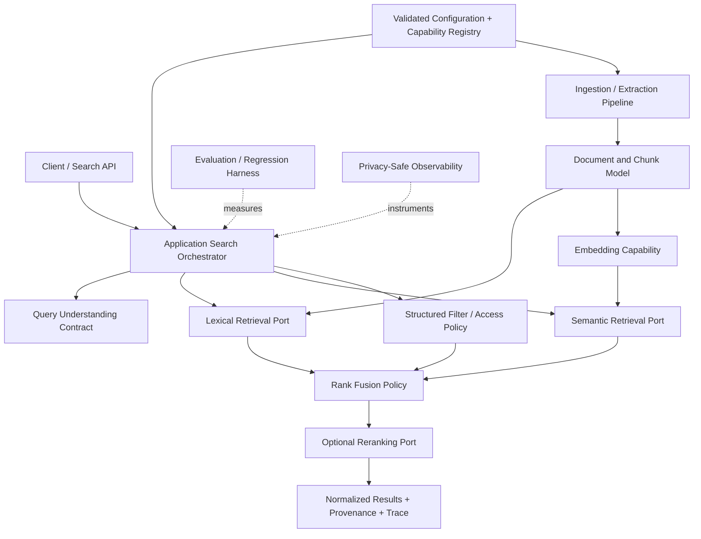

# SemanticSearchAgent — Architecture Plan

> **Status:** Target architecture; not a claim that the system is already implemented.
> **Reconciled:** 2026-10-12.
> **Detailed milestone plan:** [docs/SEMANTIC_SEARCH_AGENT_ROADMAP.md](docs/SEMANTIC_SEARCH_AGENT_ROADMAP.md)
>
> **Hard constraint:** No particular library, framework, embedding model, inference runtime, OCR engine, vector database, search backend, or AI provider is mandatory. Named technologies in examples are illustrative only and must be evaluated before adoption.

## 1. Mission and acceptance intent

Build a real natural-language semantic search system that can retrieve relevant documents based on meaning, phrasing, language, and constraints. The architecture must support replaceable implementations and evidence-based evaluation.

A core acceptance example is Vietnamese `tìm hóa đơn` retrieving relevant English documents about `invoice`, and English `find an invoice` retrieving relevant Vietnamese documents about `hóa đơn`, without hardcoded translation pairs in the search code. Similarity alone is not sufficient: evaluation must include relevant examples, ambiguous examples, and hard negatives.

The project should support both:
- **Local-only mode:** query and document content stay on the user's device; no credentials or network required.
- **Explicit remote-provider mode:** remote AI capabilities are enabled only by configuration and informed user consent. Remote use must never be silently introduced by fallback.

## 2. Current state versus target state

### Verified current state (2026-10-12)

The inspected Rust crate currently provides:
- Rule-based query parsing and normalization.
- A small compile-time concept/synonym catalogue.
- Filename, content substring, and temporal substring weighted scoring.
- Cosine similarity for vectors supplied by the caller.
- WASM-facing methods `parseQuery`, `scoreDocument`, and `computeCosineSimilarity`.

The TypeScript directory contains a provider-neutral contract foundation and a Google AI Studio REST adapter, alongside a legacy Google-specific query-planning orchestrator that has not yet been migrated fully to the new contract.

The inspected crate does **not** yet provide a complete document ingestion pipeline, persistent index lifecycle, generated embeddings, vector retrieval, a complete hybrid retrieval pipeline, OCR, or end-to-end folder search. The current weighted lexical scorer is not BM25 and is not Reciprocal Rank Fusion (RRF). The current four Rust unit tests are a small baseline, not proof of semantic or cross-lingual retrieval.

### Target capabilities

1. Provider-neutral domain and application contracts.
2. Reproducible relevance evaluation and a lexical baseline.
3. Semantic embedding and retrieval through declared, replaceable capabilities.
4. Cross-lingual retrieval validated in both directions for each claimed language pair.
5. Hybrid lexical/semantic retrieval with explicit fusion semantics.
6. Structured query constraints and safe query planning.
7. Optional reranking and bounded agentic decomposition.
8. Configurable ingestion, extraction, indexing, persistence, update/delete, and recovery.
9. Optional multimodal extraction/OCR behind a replaceable capability.
10. Observability, privacy controls, resource budgets, and regression gates.

These are target capabilities, not statements of present implementation.

## 3. Non-negotiable design principles

### 3.1 No hardcoded technology dependency

- Domain logic must not depend on provider SDKs, model-specific request types, backend-specific query APIs, or implementation-specific error classes.
- Technology choices belong in adapters and validated configuration.
- Do not scatter model IDs, vector dimensions, score thresholds, retry counts, or backend assumptions through the code.
- Capability declarations describe what an implementation actually supports and tests; do not infer capabilities from a brand name or similar API shape.
- Abstractions are justified by real replaceability, testing, lifecycle, or operational needs. Avoid abstraction for its own sake.

### 3.2 Cross-lingual semantic search is a core requirement

- General cross-lingual retrieval must not depend on hand-coded language-pair dictionaries.
- Use a semantic capability whose cross-lingual support is declared and empirically validated, or an alternative approach that passes the same evaluation gates.
- Language identification is a useful signal for processing and evaluation, but is not itself semantic matching.
- Optional domain vocabulary can improve specialized terms if it is externalized, versioned, configurable, and supplementary.
- Test query/document language pairs independently, in both directions, with hard negatives and relevance labels.

### 3.3 Privacy and consent

- Local-only operation must work without network access or AI credentials.
- Query and document content must not be sent remotely by default.
- Remote generation or embedding requires an explicit policy and user consent, and must disclose the data flow.
- A fallback route may not silently change data locality, privacy, or consent.
- Browser-delivered API keys are visible to users; do not describe them as secret. Use a trusted backend or a user-controlled secret mechanism where appropriate.
- Logs and diagnostics must redact credentials and sensitive content by default.

### 3.4 Correctness before optimization

Do not lock in performance targets or optimize for a presumed bottleneck before establishing a representative workload and baseline. Avoid claims such as a fixed accuracy percentage, absolute correctness, a fixed millisecond budget, or a fixed file-count capacity without reproducible evidence.

## 4. Logical architecture

The diagram describes responsibilities, not required processes, packages, or deployment topology.

### 4.1 Domain layer

Owns provider-neutral types and invariants, for example:
- Document identity, source, metadata, content version, and lifecycle state.
- Chunk identity, boundaries, and provenance back to the source.
- Query intent, normalized terms, structured constraints, and user-selected scope.
- Search result, evidence, rank, score metadata, and retrieval provenance.
- Embedding-space identity and index compatibility metadata.

Domain types must not import provider SDKs or a concrete storage/search implementation. Only introduce types that are needed by current use cases.

### 4.2 Application layer

Coordinates use cases:
- Ingest, update, delete, and re-index sources.
- Normalize and understand a query.
- Select available retrieval capabilities under explicit policy.
- Apply mandatory filters and access-control rules.
- Merge, deduplicate, and rank candidates.
- Produce results with provenance and trace metadata.
- Enforce cancellation, budgets, and failure handling.

Application logic depends on domain-owned contracts, not concrete adapters.

### 4.3 Contracts / ports

Define stable, provider-neutral behavior for capabilities that genuinely need replacement. Potential contracts include:
- Text extraction and document ingestion.
- Query understanding/planning.
- Text embedding.
- Lexical retrieval.
- Vector retrieval.
- Metadata filtering and storage.
- Result fusion and reranking.
- AI text generation or structured output.
- Optional OCR/multimodal extraction.

Do not require every deployment to implement every capability. A capability may be optional, but the application must detect missing required capabilities before execution.

Each contract must document inputs/outputs, errors, cancellation/timeouts, batching/pagination where relevant, consistency/lifecycle semantics, compatibility rules, and observability.

### 4.4 Adapters

Adapters translate external implementation behavior to project-owned contracts. Provider-specific API paths, model IDs, response parsing, authentication, rate limits, and error details stay inside the adapter.

An adapter must not claim unsupported capabilities. Adapter tests must cover successful behavior and negative paths without requiring a live credential for ordinary CI.

### 4.5 Configuration and capability registry

Configuration controls implementation selection and policy without scattering technology constants through domain logic. Validate configuration at startup or before use.

Configuration must express and validate, where applicable:
- Adapter/provider identifier and endpoint.
- Authentication mechanism and secret reference.
- Model identifier/revision and declared capabilities.
- Embedding dimensions, normalization, language coverage, and compatibility identity.
- Index/search settings and schema version.
- Timeouts, retries, concurrency, resource limits, and cost budgets.
- Local-only/remote processing policy and consent.
- Retrieval strategy, fusion method, and tunable thresholds.

Do not treat configuration as a way to make incompatible components appear compatible.

## 5. Query understanding and constraints

Represent query understanding as structured data rather than a free-form list of guessed keywords. Where applicable, distinguish:
- User's original query.
- Detected or declared language and confidence.
- Intent and concepts.
- Required filters and hard constraints.
- Soft preferences and ranking hints.
- Temporal expressions and their interpreted range.
- Negation and exclusions.
- Query expansions or subqueries, including their provenance.
- Ambiguities and assumptions.

Rules:
- Query rewriting may add useful interpretations but must not silently remove mandatory constraints.
- Time mentioned in a query should not automatically become a filter on filesystem modification time. The system must distinguish document-content dates, metadata dates, and file-system timestamps.
- Typo correction should be corpus-aware or otherwise evidence-based, configurable where needed, and must not silently transform identifiers or code symbols.
- Do not bake business synonyms or language-pair translations into the core source code.
- Ask for clarification when ambiguity materially changes the result and cannot be resolved safely; otherwise proceed conservatively and expose assumptions where useful.

## 6. Semantic retrieval and embedding lifecycle

Embedding generation and vector retrieval are separate capabilities. Computing cosine similarity over two caller-supplied arrays is only a mathematical primitive; it does not create embeddings or provide a search index.

### 6.1 Embedding-space identity

Each persisted embedding/index must retain sufficient compatibility metadata, including:
- Provider/implementation identity.
- Model identity and revision or immutable version.
- Vector dimension.
- Normalization and distance/similarity semantics.
- Input preprocessing/chunking version where it affects compatibility.
- Embedding schema and index version.
- Declared language coverage and evidence reference where available.

Reject incompatible query vectors or model/index combinations before searching. Never silently combine vectors from incompatible spaces.

### 6.2 Model changes and migration

Define a safe lifecycle for:
- Model/configuration changes.
- Re-embedding and index rebuild.
- Incremental progress and partial failure.
- Atomic activation or equivalent consistency guarantees.
- Rollback to the last compatible index.
- Recovery after restart.
- Deletion and invalidation of stale vectors.

### 6.3 Cross-lingual evaluation

Initial required examples:
- Vietnamese `tìm hóa đơn` → relevant English `invoice` documents.
- English `find an invoice` → relevant Vietnamese `hóa đơn` documents.
- Vietnamese `tìm biên lai thanh toán` → relevant English `payment receipt` or `proof of payment` content when the context supports it.
- English `find the signed contract` → relevant Vietnamese `hợp đồng đã ký` content.
- Mixed-language queries with temporal or other structured constraints.

Include hard negatives such as semantically related but distinct document types. These are benchmark examples, not hardcoded translation rules.

## 7. Lexical retrieval, hybrid fusion, and ranking

Lexical retrieval is a useful independent baseline and fallback. Its implementation is replaceable; the contract should describe query behavior, filters, ranking metadata, and lifecycle semantics rather than expose a particular library's API.

Semantic and lexical result lists may be fused only through an explicit, tested policy. Reciprocal Rank Fusion is one possible policy, not a mandatory technology. If the implementation uses a weighted sum of scores, call it a weighted score and define calibration/normalization; do not label it RRF.

Requirements:
- Apply authorization and mandatory filters before unauthorized data can appear in results or generated responses.
- Preserve the source rank, score type, and retrieval path for each candidate.
- Avoid comparing raw scores from unrelated systems unless they are calibrated and the calibration is validated.
- Deduplicate without losing source provenance.
- Evaluate candidate recall separately from ranking quality.
- Keep reranking optional and bounded by explicit latency, resource, and cost budgets.

## 8. Ingestion, indexing, and multimodal extraction

Build this after core contracts and evaluation foundations are stable.

The ingestion pipeline should define source identity, content extraction, chunking, metadata, update/delete semantics, index lifecycle, and error recovery. Text extraction, OCR, and format-specific parsing must be replaceable capabilities.

OCR and multimodal processing are optional stages:
- Do not OCR every file blindly.
- Select work based on content type, missing extractable text, expected value, and configured budgets.
- Use bounded queues, cancellation, resource limits, and partial-failure reporting.
- Record extraction provenance and confidence where available.
- Do not assume a specific OCR engine, worker technology, or file parser.

Index structures (inverted, n-gram, approximate vector index, or alternatives) must be selected after the workload and quality/performance baseline are measured. Do not mandate a named algorithm or dependency in the domain architecture.

## 9. Provider-neutral AI integration

AI models may assist with query understanding, structured planning, embeddings, or reranking only when a selected adapter actually implements the required capability.

- Use project-owned contracts for generation, structured output, embeddings, and any future capabilities.
- Discover model capabilities at runtime when supported; otherwise require explicit, validated configuration.
- Validate model-produced plans against a schema and re-check all mandatory constraints in application code.
- Normalize authentication, permission, quota, rate-limit, timeout, cancellation, network, invalid-response, unsupported-capability, and provider-unavailable errors.
- Retry only appropriate failures under a bounded policy.
- Fallback routes must be explicit, capability-compatible, and privacy-compatible.
- Track request correlation, usage/cost where available, and secret-safe diagnostics.
- A second independent adapter or standards-based/custom endpoint adapter is required to demonstrate that the abstraction is not merely a wrapper around one vendor.

Google AI Studio is one supported integration target, not the architectural center and not proof of local-only privacy. Its current implementation status is documented in `docs/AI_PROVIDER_ARCHITECTURE.md`.

## 10. Evaluation and observability

### Evaluation

Maintain versioned corpora, queries, relevance judgments, configuration, and benchmark outputs. Report appropriate measures such as Recall@K, Precision@K, MRR, nDCG@K, latency percentiles, resource use, and cost. State dataset limitations and avoid overclaiming from small samples.

Measure:
- Lexical-only baseline.
- Semantic-only retrieval.
- Hybrid retrieval.
- Query understanding/constraint preservation.
- Optional reranking.
- Cross-lingual performance in both directions.
- Hard negatives, misspellings, mixed-language queries, negation, dates, and ambiguity.
- Failure and degraded modes.

### Observability

Capture pipeline stage, duration, selected capabilities, normalized error category, result provenance, and resource/cost counters where available. Do not log raw document/query content or secrets by default. Content-level diagnostics require an explicit user-controlled policy.

## 11. Security, reliability, and recovery

- Treat documents and model output as untrusted data.
- Enforce access control independently of query planning and ranking.
- Validate all external inputs and model-generated structured output.
- Bound recursion, subqueries, candidate counts, concurrency, memory, time, tokens, and cost.
- Make retries, cancellation, and fallback observable.
- Test partial ingestion, interrupted indexing, restarts, stale data, incompatible snapshots, and rollback.
- Deleted or unauthorized documents must not reappear through caches, stale indexes, or fallback paths.

## 12. Milestone sequence and decision gates

Use the detailed roadmap as the source of truth for task-level acceptance criteria:

1. **M00 — Repository audit and architecture baseline.**
2. **M01 — Provider-neutral search core.**
3. **M02 — Evaluation harness and lexical baseline.**
4. **M03 — Semantic/cross-lingual retrieval and embedding lifecycle.**
5. **M04 — Hybrid retrieval and structured constraints.**
6. **M05 — Natural-language and cross-lingual query understanding.**
7. **M06 — Reranking and relevance optimization.**
8. **M07 — Controlled search agent.**
9. **M08 — Production hardening, security, and recovery.**
10. **M09 — Continuous evaluation and optimization.**
11. **M10/M11 — Follow-on deployment, integration, or scale work only as defined and accepted in the detailed roadmap.**
12. **M12 — Provider-agnostic AI model integration is a cross-cutting capability track; it must not be interpreted as permission to skip M00–M11 quality gates.**

Milestones are quality gates, not calendar promises. Implement only after prior dependencies and acceptance criteria are satisfied. Do not begin specialized performance optimization before a relevant benchmark identifies the bottleneck.

## 13. Definition of done

The system is not a mature natural-language semantic search system until evidence shows that:
- Paraphrases and relevant concepts retrieve documents without exact keyword overlap being mandatory.
- Cross-lingual search works in both directions for every declared language pair, without hardcoded translation pairs.
- Lexical, semantic, filters, fusion, and reranking can evolve independently.
- Provider/model/backend replacement does not require rewriting domain rules.
- Incompatible embeddings/indexes are rejected safely.
- Mandatory constraints and access controls cannot be dropped by an agent or fallback.
- Results expose provenance and traceable ranking evidence.
- Evaluation is reproducible and regression-gated.
- Failure, recovery, privacy, performance, and cost behavior are tested and documented.
- Documentation distinguishes implemented behavior from proposed capabilities.
